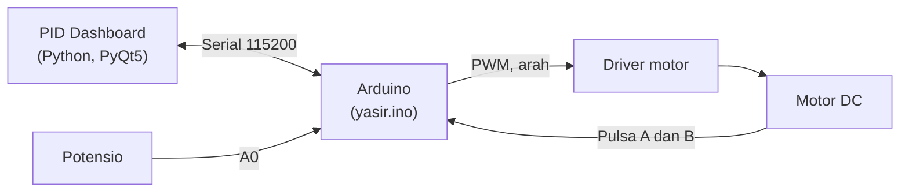

<div align="center">

# PID Dashboard

**Panel kontrol dan monitoring motor DC berbasis encoder, dengan grafik real-time dan kontrol PID lewat Arduino.**


<br/><br/>

<a href="#instalasi"></a>
<a href="#fitur"></a>
<a href="#cara-pakai"></a>
<a href="#wiring-hardware"></a>
<a href="#pemecahan-masalah"></a>

</div>

<br/>

## Ringkasan

PID Dashboard adalah aplikasi desktop untuk mengendalikan satu motor DC dengan encoder. Aplikasi ini berbicara dengan Arduino lewat serial (115200 baud), menampilkan data kecepatan, posisi, dan PWM secara langsung, dan memungkinkan kamu menyetel parameter PID sambil melihat responsnya di grafik.

Satu tampilan untuk semuanya: pilih mode, geser set point, atur Kp, Ki, Kd, lalu amati hasilnya.

## Fitur

| Fitur | Keterangan |
|:------|:-----------|
| Enam mode kontrol | Off, Open Loop, Close Loop, PID Kecepatan, PID Posisi, dan Potensio |
| Grafik real-time | Target dan nilai aktual digambar langsung dengan pyqtgraph |
| Kartu telemetri dan gauge | Target, nilai aktual, PWM, dan sudut dalam satu layar |
| Tuning PID langsung | Ubah Kp, Ki, Kd kapan saja, nilainya dikirim ke Arduino dan disimpan otomatis |
| Analisis respons transien | Pantau respons saat set point berubah |
| Set point cepat | Slider dan tombol preset yang bisa diubah per mode |
| Simpan dan muat preset | Parameter PID disimpan ke file JSON |
| Ekspor CSV | Simpan data hasil percobaan untuk dianalisis |
| Mode Simulasi | Coba semua tampilan tanpa Arduino |
| Deteksi port otomatis | Tombol Pindai mencari Arduino yang tersambung |
| Tombol Emergency | Menghentikan motor seketika |
| Toolkit lanjutan | Custom Mode, Kalibrasi Encoder, Generator Sinyal, dan Tuning PID Ziegler-Nichols |

## Cara Kerja



Arduino membaca encoder, menjalankan kontrol, dan mengirim telemetri setiap 50 ms dalam format `mode,target,aktual,pwm`. Dashboard menerima data itu, menggambar grafik, dan mengirim perintah balik.

### Mode kontrol

| Mode | Nama | Satuan | Rentang bawaan |
|:----:|:-----|:------:|:--------------:|
| 0 | Off | derajat | -255 sampai 255 |
| 1 | Open Loop | PWM | -1360 sampai 1360 |
| 2 | Close Loop | rpm | -1360 sampai 1360 |
| 3 | PID Kecepatan | rpm | -1360 sampai 1360 |
| 4 | PID Posisi | derajat | -180 sampai 180 |
| 5 | Potensio | derajat | -180 sampai 180 |

Rentang dan preset tiap mode bisa diubah lewat Custom Mode di toolkit.

## Instalasi

Pilih sistem operasi kamu, lalu klik untuk membuka langkahnya.

**Yang dibutuhkan:** Python 3.10 atau lebih baru (dikembangkan dengan 3.12), Git, dan Arduino IDE untuk mengunggah firmware.

<details>
<summary><b>Windows</b></summary>
<br/>

**1. Pasang prasyarat**

- Python dari [python.org/downloads](https://www.python.org/downloads/). Saat instalasi, centang **Add python.exe to PATH**.
- Git dari [git-scm.com](https://git-scm.com/download/win).

**2. Unduh proyek dan pasang dependensi**

Buka PowerShell, lalu jalankan:

```powershell
git clone https://github.com/kyami-sirr/PID-dashboard.git
cd PID-dashboard
py -3 -m venv .venv
.venv\Scripts\Activate.ps1
python -m pip install --upgrade pip
pip install -r requirements.txt
```

Kalau muncul pesan bahwa skrip tidak boleh dijalankan, izinkan sekali lalu ulangi langkah aktivasi:

```powershell
Set-ExecutionPolicy -Scope CurrentUser RemoteSigned
```

**3. Jalankan**

```powershell
python dashboard.py
```

**4. Jalur Arduino**

Arduino akan muncul sebagai port `COM3`, `COM4`, dan seterusnya. Kalau tidak muncul di Device Manager, pasang driver sesuai chip board kamu (CH340 atau FTDI).

</details>

<details>
<summary><b>Linux (Ubuntu, Debian, Linux Mint)</b></summary>
<br/>

**1. Pasang prasyarat**

```bash
sudo apt update
sudo apt install -y git python3 python3-venv python3-pip libxcb-xinerama0
```

Distro lain: di Fedora pakai `sudo dnf install git python3`, di Arch pakai `sudo pacman -S git python`.

**2. Unduh proyek dan pasang dependensi**

```bash
git clone https://github.com/kyami-sirr/PID-dashboard.git
cd PID-dashboard
python3 -m venv .venv
source .venv/bin/activate
pip install --upgrade pip
pip install -r requirements.txt
```

**3. Izinkan akses port serial**

```bash
sudo usermod -aG dialout $USER
```

Setelah itu **keluar dan masuk lagi** (logout dan login) supaya izin berlaku.

**4. Jalankan**

```bash
source .venv/bin/activate
python dashboard.py
```

**5. Jalur Arduino**

Arduino akan muncul sebagai `/dev/ttyUSB0` atau `/dev/ttyACM0`. Cek dengan `ls /dev/ttyUSB* /dev/ttyACM*`.

</details>

<details>
<summary><b>Unggah firmware ke Arduino (semua sistem operasi)</b></summary>
<br/>

1. Buka **Arduino IDE**, lalu buka file `yasir.ino`. Kalau IDE meminta memindahkan sketch ke folder bernama `yasir`, setujui saja.
2. Pilih board dan port di menu **Tools**.
3. Klik **Upload**.
4. Tutup Serial Monitor sebelum membuka dashboard, karena port yang sedang dipakai tidak bisa dibuka dua program sekaligus.

Pin 2 dan 3 dipakai untuk interrupt encoder, jadi gunakan board yang mendukungnya di dua pin itu (misalnya Arduino Uno atau Nano).

</details>

## Wiring Hardware

| Fungsi | Pin Arduino |
|:-------|:-----------:|
| Driver motor, kecepatan (ENA) | 5 |
| Driver motor, arah (IN1) | 7 |
| Driver motor, arah (IN2) | 4 |
| Encoder fase A | 2 |
| Encoder fase B | 3 |
| Potensio | A0 |
| LED indikator mode Potensio | 6 |

Hubungkan GND Arduino, driver, dan sumber daya motor menjadi satu.

## Cara Pakai

1. Jalankan `python dashboard.py`.
2. Klik **Pindai** untuk mencari port, lalu klik **Hubungkan**.
3. Pilih mode kontrol, lalu geser slider atau klik preset untuk mengatur set point.
4. Untuk mengubah Kp, Ki, dan Kd, centang **Buka Kunci PID**.
5. Klik **Atur PPR** kalau jumlah pulsa encoder kamu berbeda. Nilai PPR bisa diukur lewat Kalibrasi Encoder di toolkit.
6. Klik **Ekspor CSV** untuk menyimpan data, atau **Reset Grafik** untuk memulai ulang tampilan.
7. Dalam keadaan darurat, klik **EMERGENCY (STOP)**.

Belum punya hardware? Centang **Mode Simulasi** untuk mencoba semua tampilan tanpa Arduino. Ini juga cara cepat untuk memastikan instalasi berhasil.

## Pemecahan Masalah

<details>
<summary><b>Port tidak terdeteksi</b></summary>
<br/>

Coba kabel USB lain (sebagian kabel hanya untuk pengisian daya), klik **Pindai** lagi, dan pastikan driver terpasang di Windows. Pastikan Serial Monitor Arduino IDE sudah ditutup.

</details>

<details>
<summary><b>Linux: Permission denied pada /dev/ttyUSB0 atau /dev/ttyACM0</b></summary>
<br/>

Akun kamu belum masuk grup `dialout`. Jalankan `sudo usermod -aG dialout $USER`, lalu logout dan login lagi.

</details>

<details>
<summary><b>Linux: error "xcb" atau jendela tidak mau muncul</b></summary>
<br/>

Pasang pustaka yang dibutuhkan Qt: `sudo apt install libxcb-xinerama0`. Pastikan kamu menjalankannya di sesi desktop grafis, bukan lewat SSH tanpa X forwarding.

</details>

<details>
<summary><b>Windows: skrip aktivasi venv diblokir</b></summary>
<br/>

Jalankan `Set-ExecutionPolicy -Scope CurrentUser RemoteSigned` di PowerShell, lalu ulangi aktivasi.

</details>

<details>
<summary><b>Data masuk tapi angkanya aneh atau arah motor terbalik</b></summary>
<br/>

Periksa nilai PPR (Atur PPR atau Kalibrasi Encoder). Kalau arah terbalik, tukar kabel fase A dan B encoder, atau tukar kabel motor pada driver.

</details>

## Protokol Serial

Dashboard dan Arduino saling bertukar teks satu baris pada 115200 baud.

| Arah | Format | Fungsi |
|:----:|:-------|:-------|
| Ke Arduino | `M:mode:target` | Ganti mode dan set point |
| Ke Arduino | `P:S:kp:ki:kd` | Atur PID kecepatan |
| Ke Arduino | `P:P:kp:ki:kd` | Atur PID posisi |
| Ke Arduino | `K:ppr` | Atur PPR encoder |
| Ke Arduino | `Z` | Nolkan posisi |
| Ke Arduino | `DIAG` | Diagnostik hardware |
| Dari Arduino | `mode,target,aktual,pwm` | Telemetri tiap 50 ms |

## Struktur Proyek

```text
PID-dashboard/
  dashboard.py          jendela utama
  controller.py         mesin PID di sisi Python
  serial_worker.py      pembaca serial di thread terpisah
  gauge_widget.py       widget gauge sudut
  yasir.ino             firmware Arduino
  closeloop.json        preset parameter PID
  config_settings.json  pengaturan mode dan tampilan
  requirements.txt      dependensi Python
  panel/                panel grafik, kartu, koneksi, PID, skema
  alat/                 toolkit: mode, enkoder, sinyal, rumus PID
```

## Pengaturan Tersimpan

Pengaturan disimpan otomatis ke `config_settings.json` (mode, PID, PPR, tampilan) dan `closeloop.json` (preset PID). Hapus file itu kalau ingin mengembalikan ke pengaturan awal.

## Keselamatan

- Uji pertama kali dengan motor tanpa beban.
- Jangan tinggalkan motor menyala tanpa pengawasan.
- Mulai dari Kp kecil, lalu naikkan perlahan. Kp yang terlalu besar membuat motor berosilasi.
- Pastikan tombol **EMERGENCY (STOP)** mudah dijangkau.

## Pembuat

Dibuat oleh **Muhammad Yasir Assafa** ([@kyami-sirr](https://github.com/kyami-sirr)).

Kalau proyek ini bermanfaat, kasih bintang ya.
